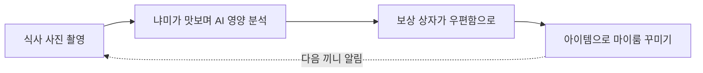
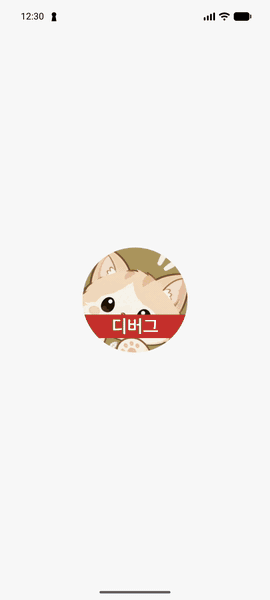
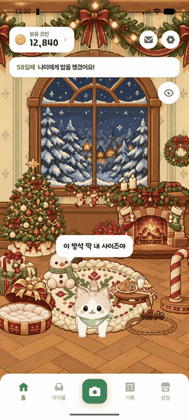
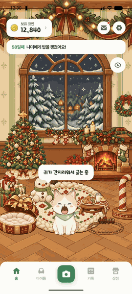
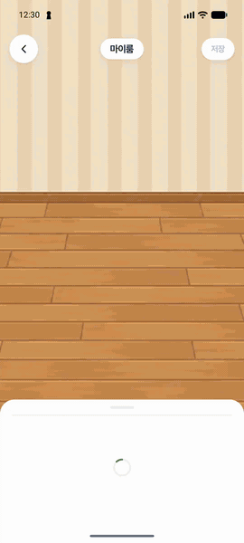
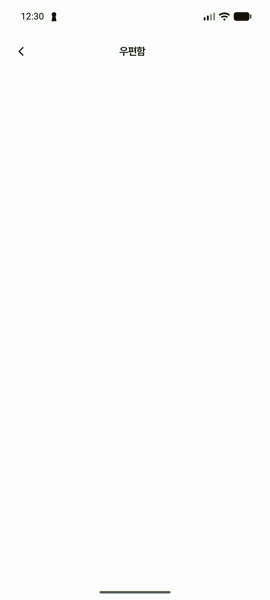
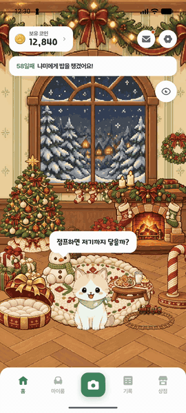
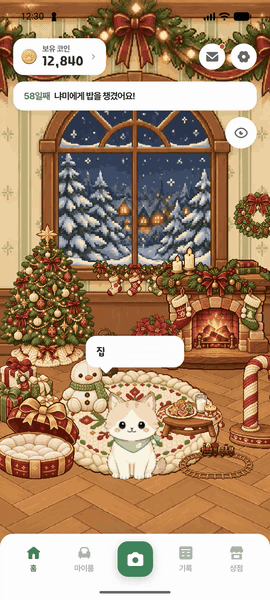
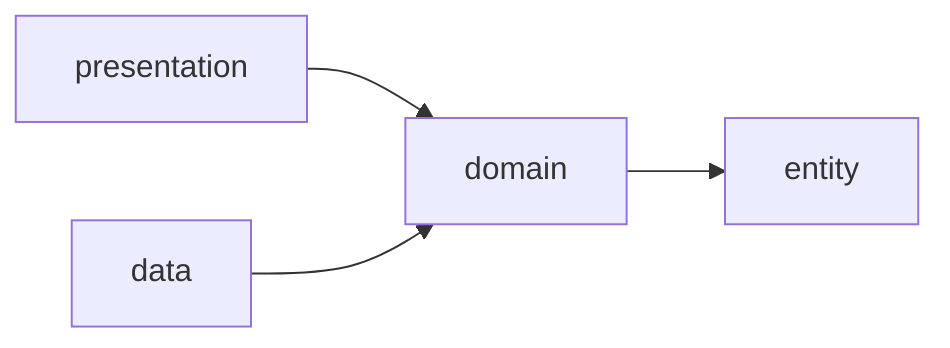
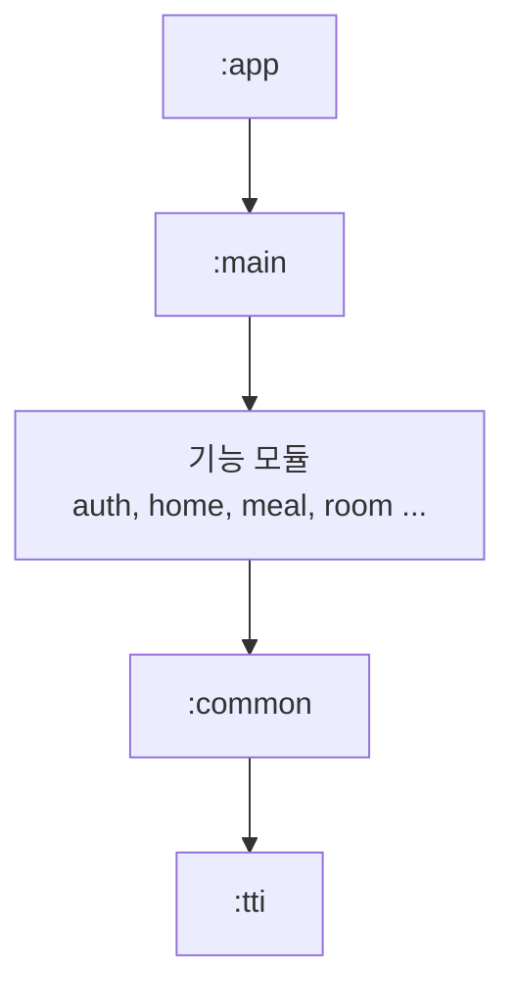

# 냐미 Android

사진 한 장으로 식사를 기록하고, 고양이 냐미를 돌보며 기록 습관을 만드는 앱입니다.

  

[Google Play](https://play.google.com/store/apps/details?id=com.dandi.nyummy)

## 냐미는

식단 기록 앱은 입력이 번거로워서 며칠 쓰다 멈추기 쉽습니다. 냐미는 기록을 사진 한 장으로 줄이고, 기록할 때마다 냐미가 반응하고 보상을 주는 흐름으로 다시 앱을 열 이유를 만듭니다.

## 화면

<table>
  <tr><td align="center"><b>시작하기</b></td><td align="center"><b>홈</b></td><td align="center"><b>식사 기록</b></td><td align="center"><b>마이룸</b></td></tr>
  <tr><td align="center"></td><td align="center"></td><td align="center"></td><td align="center"></td></tr>
  <tr><td align="center">골목에서 냐미를 만나는 온보딩</td><td align="center">꾸민 방에서 말을 거는 냐미</td><td align="center">촬영, 냐미가 먹는 연출, 보상 상자</td><td align="center">아이템을 꺼내고 옮겨 방 꾸미기</td></tr>
  <tr><td align="center"><b>우편함</b></td><td align="center"><b>기록 돌아보기</b></td><td align="center"><b>설정</b></td></tr>
  <tr><td align="center"></td><td align="center"></td><td align="center"></td></tr>
  <tr><td align="center">보상 상자 열기, 모두 받기</td><td align="center">캘린더, 하루 영양, 식사 상세</td><td align="center">식사 시간 알림, 문의 내역</td></tr>
</table>

## 기능

| 기능 | 하는 일 | 모듈 |
|---|---|---|
| 시작하기 | 온보딩 스토리, 이메일·카카오·구글 로그인, 비밀번호 재설정, 자동 로그인 | `intro` `onboarding` `auth` |
| 식사 기록 | CameraX 원샷 촬영, 업로드 후 AI 영양 분석, 기록 완료 연출 | `meal` |
| 홈 | 냐미 상태와 대사, 오늘의 식사 요약 | `home` `cat` |
| 마이룸 | 받은 아이템으로 방 꾸미기 | `room` |
| 우편함 | 식사 보상 상자와 아이템 수령 | `mailbox` |
| 기록 돌아보기 | 월간 캘린더, 하루 영양 요약, 식사 이름 수정·삭제, 분석 평가 | `history` |
| 설정 | 식사 시간 알림, 문의하기, 약관, 회원탈퇴 | `settings` `legal` |
| 알림과 링크 | FCM 푸시, `link.nyummy.co.kr` 앱 링크로 화면 바로 열기 | `app` `main` |

마이룸, 우편함 아이템 탭 같은 기능은 Firebase Remote Config 플래그로 켜고 끕니다. 앱 버전 체크와 강제 업데이트, 홈 진입 시 띄우는 앱 공지도 같은 방식입니다.

## 기술 선택

| 영역 | 사용 | 이유 |
|---|---|---|
| UI | Jetpack Compose, Material3, Coil3 | 선언형 UI와 자체 디자인 시스템(`NyummyTheme`) |
| 내비게이션 | Navigation3 | 라우트 레지스트리 하나로 화면, 딥링크, 앱 링크 경로를 함께 관리 |
| 상태 관리 | MVI, Coroutines, Flow | 입력은 `onIntent` 하나, 상태 변경은 `reduce`에서만 |
| 네트워크 | Retrofit3, OkHttp5, kotlinx.serialization | 서버 응답이 일정하지 않을 때를 대비해 DTO 필드를 모두 nullable로 받고 VO로 변환 |
| DI | Hilt, KSP | 멀티모듈 전체를 `:app`에서 조립 |
| 저장 | DataStore | 토큰과 로컬 설정 |
| 카메라 | CameraX | 촬영 화면 직접 구성 |
| 원격 설정 | Firebase Remote Config | 서버와 앱의 배포 속도 차이를 기능 플래그로 흡수하고, 강제 업데이트와 홈 진입 시 앱 공지(JSON)도 같은 경로로 내려받음. 키마다 타입, 직렬화기, 기본값을 묶은 제네릭 `RemoteConfigKey<T>`로 설계해 Boolean 플래그부터 JSON 공지까지 같은 방식으로 읽음 |
| 로그 | Firebase Analytics, Crashlytics, Performance, Meta 앱 이벤트 | 출시 지표 측정과 크래시 추적 |
| 성능 | TTI 계측, JankStats | 화면이 쓸 수 있게 되기까지 걸린 시간과 프레임 드랍을 숫자로 확인 |
| 로그인 | Kakao SDK, Credential Manager | 카카오, 구글 소셜 로그인 |
| CI | GitHub Actions | PR마다 `assembleDebug`, `lintDebug` |

## 구조

기능마다 `entity` / `domain` / `data` / `presentation` 네 모듈로 나눕니다. `entity`와 `domain`은 Android에 의존하지 않고, `presentation`과 `data`는 서로를 모릅니다.

### common

여러 기능이 함께 쓰는 기반입니다. 기능과 같은 네 모듈로 나뉘고, 각 기능 모듈은 같은 층의 common 모듈에 의존합니다.

| 모듈 | 역할 |
|---|---|
| `common:entity` | 여러 기능이 같이 쓰는 값과 상수 (시간, 태그, 원격 설정 값 등) |
| `common:domain` | `BaseUseCase`, 공통 오류 처리, 화면 이동 계약, 원격 설정 키(`RemoteConfigKey<T>`), 분석 이벤트 |
| `common:data` | Retrofit, OkHttp, Json 설정과 `BaseRemoteDataSource`, 토큰 저장, 이미지 업로드, 푸시 토큰, 원격 설정 구현 |
| `common:presentation` | MVI 기반 클래스, 디자인 시스템(`NyummyTheme`), 코치마크, JankStats |

### 기능 모듈이 아닌 모듈

| 모듈 | 역할 |
|---|---|
| `:app` | Application, 전체 Hilt 그래프 조립, FCM 메시지 수신. 조립을 위해 모든 모듈에 의존합니다. |
| `:main` | `MainActivity`와 Navigation3 앱 셸. 모든 화면을 `AppRouteRegistry`에 등록하고, 딥링크와 앱 링크를 화면으로 연결합니다. |
| `:tti` | 화면이 쓸 수 있게 되기까지 걸린 시간(TTI)을 재는 모듈. Android에 의존하지 않는 Kotlin/JVM 모듈입니다. |

## 부딪힌 문제들

개발하며 부딪힌 문제와 해결 과정은 [트러블 슈팅](https://app.notion.com/p/3f23c5cd24f48018bee8c6b2f20a9117#3f23c5cd24f480688debfec0a8c80d5d)에 정리했습니다.

## 문서

- [개발 가이드](docs/DEVELOPMENT.md): 모듈 규칙, 로컬 설정, 빌드와 테스트
- [아키텍처 문서](docs/architecture/): MVI, Navigation3, 데이터 레이어, 에러 처리, 디자인 시스템, 성능 계측

## 팀

팀 단디 (소프트웨어 마에스트로 17기)

| Android |
|:---:|
| <a href="https://github.com/nonani"> nonani</a> |
